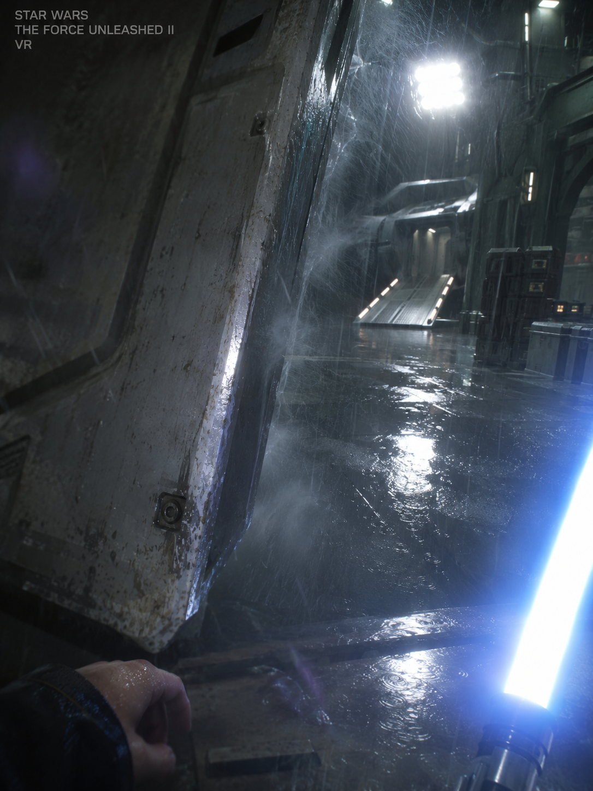
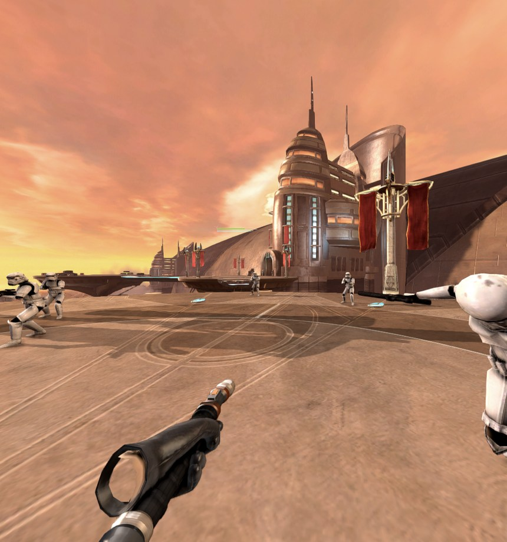

> [!IMPORTANT]
> **DOWNLOAD & DISCUSSION**
>
> **[Join the Flat2VR Discord](https://discord.gg/P4q9zt7ek)** · **[Open the Force Unleashed II thread](https://discord.com/channels/747967102895390741/1569880803389874196)**
>
> Get the mod and share feedback in the game’s Flat2VR thread.

  

## Features

**Stereo head tracking · Two independently tracked lightsabers · Limb severing · Force powers in either hand**

###  Switch each lightsaber on or off on its own

Hold one saber in each hand, ignite them independently and swing both with your controllers.

###  Sever enemy limbs with a saber swing

Swing through an enemy’s arm to cut it off. The blade can also sever other body parts at the point of impact.

###  Hold an enemy with the Force and strike with your other hand

Lift, rotate or throw enemies and props with a gesture. Keep a Stormtrooper suspended with one hand while you swing your saber with the other.

###  Cast Force lightning from either hand

Point and use lightning with your left or right hand.

###  Stand on a crate and fly with the Force

Step onto a crate, lift it with the Force and ride it through the air.

## Installation

1. Install **The Force Unleashed II** from GOG.
2. **Put the mod archive next to `SWTFU2.exe`.** Extract the whole archive there and keep the mod folder intact.
3. Connect your PC VR headset, select your OpenXR runtime, and run **`RUN.bat`** from the extracted mod folder. If the launcher needs the game path, set `game_directory` in `app/settings.json`.

## In-game screenshots

  
  

[Tester credits](TESTERS.md)

## Other VR mods

| VR mod | Highlights |
| --- | --- |
| [Alone in the Dark (2008) VR](https://github.com/Monsterdeadwood/AloneInTheDark2008VR) | Sweep a flashlight across the room, then grab a chair and carry it by hand. |
| [Battlefield 3: VRevamp](https://github.com/Monsterdeadwood/Battlefield-3-VRevamp) | Pull a dropped enemy rifle toward you, take it with your other hand and fire. |
| [Burnout Paradise Remastered VR](https://github.com/Monsterdeadwood/BUrnOutPvr) | Look into a corner, drift through it and hit boost as you straighten out. |
| [Crysis 2: VRevamp](https://github.com/Monsterdeadwood/C2VR) | Lift an enemy with your free hand and fling them across the room with a swing. |
| [NOVA · CS:GO Legacy VR](https://github.com/Monsterdeadwood/CSGOVR) | Bring the AWP’s scope up to your eye and feel the kick when you shoot. |
| [Metro 2033 VR](https://github.com/Monsterdeadwood/Metro2033VR) | Ricochet a glowing power core down a tunnel and watch it light the walls as it travels. |
| [Rainbow Six Siege VR](https://github.com/Monsterdeadwood/SiegeVR) | Reach for the rifle’s foregrip and steer the muzzle with both hands. |
| [TimeShift VR](https://github.com/Monsterdeadwood/TimeShiftVR) | Let go of the foregrip for a quick punch, or strike with the rifle itself. |
| [Titanfall 1 VR](https://github.com/Monsterdeadwood/Titanfall1VR) | Call down a Titan, climb in and send captured shots back with the Vortex Shield. |
| [You Are Empty: Absolute Edition VR](https://github.com/Monsterdeadwood/YouAreEmptyAEVR) | Keep your gun trained ahead with your right hand and strike with your free left. |
