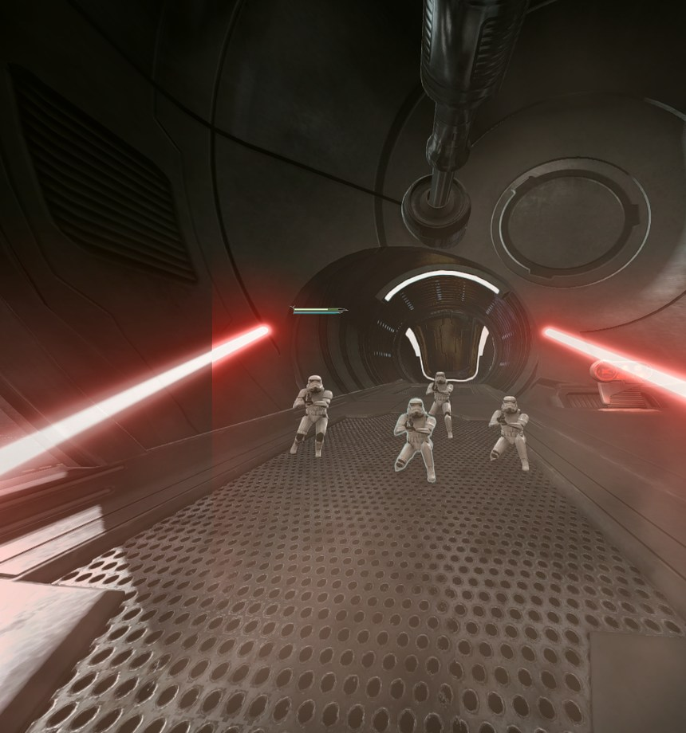

> [!IMPORTANT]
> **💬 TEST BUILDS & DISCUSSION**
>
> **[Join the Flat2VR Discord](https://discord.gg/P4q9zt7ek)** · **[Open the Force Unleashed II thread](https://discord.com/channels/747967102895390741/1569880803389874196)**
>
> Download the latest test build from the thread and share your results there.

  

## 📦 INSTALLATION

1. Install the supported **GOG PC version** and get the **TFU2_OPENXR_R53** test package.
2. Extract the complete mod into its own folder.
3. Connect PC VR, select your OpenXR runtime, and run **`RUN.bat`**. If needed, set `game_directory` in `app/settings.json`.

## ⚡ FEATURES

### TWO SABERS, TWO TRACKED BLADES

Swing either saber independently. In tested encounters the blade’s actual point of contact determines which supported joint is cut.

### GRAB WITH THE FORCE. STRIKE WITH THE OTHER HAND.

Reach to pull a prop or enemy, turn your wrist to rotate it, and release with a throw. R49 kept a hostile Stormtrooper held through a hit from the other hand.

### FORCE LIGHTNING FROM EITHER HAND

Use controller-directed lightning and switch between five blade forms.

The GOG tests used XR Sim. The combined Grip and saber check was performed in R49.

## 📸 In-game screenshots

  
  

[Tester credits](TESTERS.md) · [Build details](docs/PROJECT_STATUS.md)

## 🎮 Other VR mods

| VR mod | Highlights |
| --- | --- |
| [Alone in the Dark (2008) VR](https://github.com/Monsterdeadwood/AloneInTheDark2008VR) | Tracked item handling and hand contact with walls |
| [Battlefield 3: VRevamp](https://github.com/Monsterdeadwood/Battlefield-3-VRevamp) | Body holsters, two-handed aiming, and changing campaign skies |
| [Burnout Paradise Remastered VR](https://github.com/Monsterdeadwood/BUrnOutPvr) | Head-tracked driving with stereo boost and exhaust effects |
| [Crysis 2: VRevamp](https://github.com/Monsterdeadwood/C2VR) | Physical melee, object grabbing, and a rooftop weapon range |
| [NOVA · CS:GO Legacy VR](https://github.com/Monsterdeadwood/CSGOVR) | Controller aiming and working optics in local bot matches |
| [Metro 2033 VR](https://github.com/Monsterdeadwood/Metro2033VR) | Telekinesis, hand lightning, and object physics |
| [Rainbow Six Siege VR](https://github.com/Monsterdeadwood/SiegeVR) | Tracked weapons and two-handed foregrip handling |
| [TimeShift VR](https://github.com/Monsterdeadwood/TimeShiftVR) | Randomized weather, day and night, and roomscale crouching |
| [Titanfall 1 VR](https://github.com/Monsterdeadwood/Titanfall1VR) | Aim with the controller and look around a Titan cockpit |
| [You Are Empty: Absolute Edition VR](https://github.com/Monsterdeadwood/YouAreEmptyAEVR) | Tracked weapons and melee with either hand |
