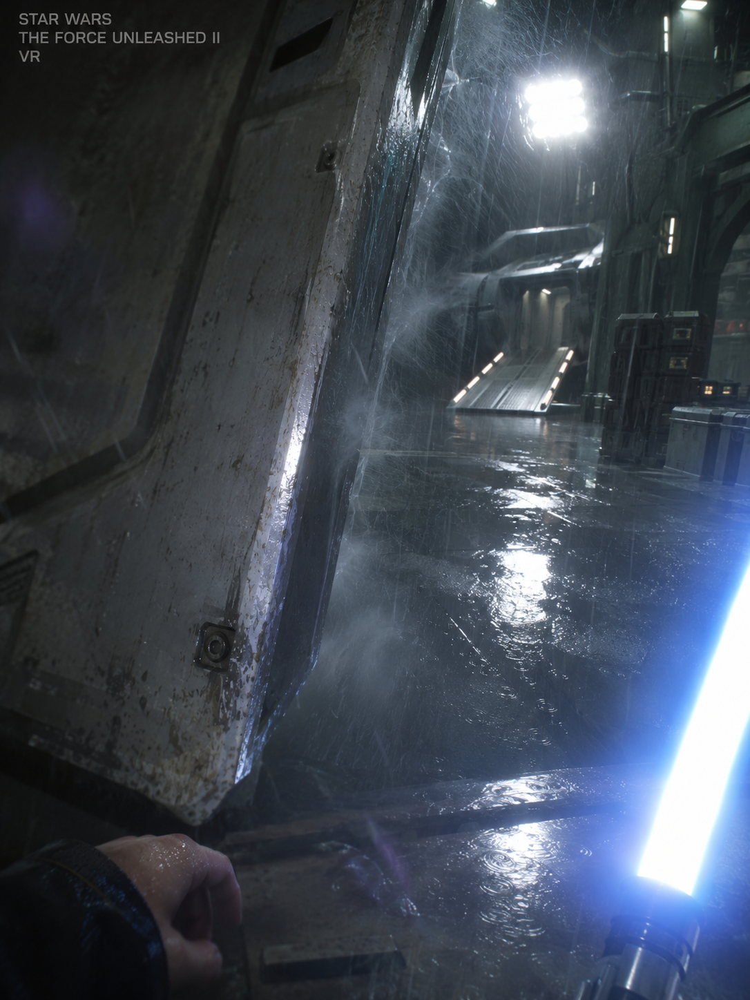

> [!IMPORTANT]
> **[ТЕСТИРОВАНИЕ И ОБСУЖДЕНИЕ · FLAT2VR DISCORD](https://discord.gg/P4q9zt7ek)**
> Тестирование, запрос сборок, отзывы и обсуждение проходят в **Flat2VR Modding Discord**. Перейди на сервер и найди тему **The Force Unleashed II**.

  

# Star Wars: The Force Unleashed II VR

[English](README.md) · [Русский](README_RU.md) · [Flat2VR Discord](https://discord.gg/P4q9zt7ek) · [All projects](PORTFOLIO.md)

VR-мод Star Wars: The Force Unleashed II со световыми мечами от контроллеров, независимым телекинезом рук и управлением Силой. R47 точнее привязывает отсечение к касанию клинка и синхронизирует эффекты попадания между глазами.

**Текущая описанная ветка: OpenXR R47 test package.**

## Установка

1. Запроси **TFU2_OPENXR_R47** в теме **The Force Unleashed II** на Flat2VR. Поддерживаемая PC-игра должна быть установлена отдельно.
2. Распакуй папку **TFU2_OPENXR_R47** целиком. Подключи шлем, выбери активную среду OpenXR в программе для PC VR и запусти **RUN.bat** из папки мода.
3. Если игра не найдена, укажи её папку в поле **game_directory** файла **app/settings.json**. Для теста Steam-версии сначала запусти Steam и учти ограничения совместимости ниже.
4. Оставь окно запуска открытым. Для отчёта на Flat2VR укажи шлем, среду XR, издание игры и сцену. Приложи текстовый архив TELEMETRY, если он создан, или текст ошибки из консоли, если игра не запустилась.

Доступность актуальных тестовых пакетов уточняется в Discord. Нужен полный пакет для поддерживаемой версии игры; страница проекта сама по себе не является скачиваемым релизом.

## Что есть в проекте

- OpenXR-стерео и привязка рук и мечей к трекингу в поддерживаемых сценах.
- Меч в каждой руке, отдельное включение триггерами и пять переключаемых форм клинка. Первый вариант использует родной красный эффект игры и новую рукоять; остальные сохраняют случайные парные цвета на сеанс.
- Независимый телекинетический хват предметов и врагов: движение руки меняет дальность, поворот кисти вращает цель, а отпускание с движением даёт бросок.
- Молния каждой руки, общая команда Силы и проверенный маршрут движения на собственной удерживаемой опоре.
- Настройка положения и поворота хвата отдельно для рук, с общей привязкой ладони, рукояти, клинка и контакта.
- Настроенные штатные реакции врагов с сохранением исходного урона и действий кристаллов.
- Оба клинка могут отсекать подготовленные части модели противника в поддерживаемых суставах. В R47 выбор сустава и плоскость отсечения определяются положением клинка в момент попадания.
- Выпуклый экран меню и видео, управление меню с контроллеров и обновлённый маршрут родного звука.

<b>Краткое управление</b>

| Действие / кнопка | Назначение |
| --- | --- |
| Each hand’s trigger | Включить / выключить меч этой руки |
| Each hand’s Grip | Удержать предмет/врага телекинезом; двигать и вращать рукой; отпустить с движением для броска |
| Y left / B right | Молния соответствующей руки |
| X left | Общее действие Силы для двух рук; сохраняет опору при движении на ней |
| A right | Прыжок / второй прыжок; спрыгнуть с опоры |
| Left stick | Движение; при захвате горизонталь сдвигает удерживаемые цели, вертикаль сохраняет ходьбу |
| Right stick horizontal / vertical | Поворот / высота удерживаемых целей; без захвата вертикаль сохраняет раздельный обратный хват |
| Right stick click | Переключить пять форм клинка |
| Left Menu tap / hold | Центр / пауза |
| Menus and movies: A / B | Выбрать / назад; отпустить B справа и удерживать не менее 0,7 секунды для пропуска ролика |

Полная инструкция управления в конкретной сборке учитывает её версию и профиль контроллеров.

## Текущий статус

**Экспериментальная сборка.** В игре с XR Sim проверены отсечение с каждого контроллера, пять подготовленных частей модели штурмовика, их физическое отделение, эффекты попаданий в обоих глазах и восстановление изображения после краткой остановки при ударе.

- Проверенный игровой код — GOG. Присланный Steam EXE распознаётся с защитными проверками, но настоящий лицензионный Steam-запуск и совместимость его зависимостей ещё требуют теста.
- В R45 проверены вход во все девять штатных миров кампании и QTE при крушении корабля. Полное прохождение кампании и боссов ещё предстоит проверить. Лаунчер запускает игру с -noSaving.
- Звук через Air Link, удобство в шлеме и работа разных контроллеров ещё требуют проверки.

[Подробный статус и область проверки](docs/PROJECT_STATUS.md)

## Тестирование и отзывы

Напиши в [тему игры на Flat2VR](https://discord.gg/P4q9zt7ek): укажи **версию мода, игру/магазин, шлем, OpenXR runtime, GPU, шаги воспроизведения и диагностический ZIP сборки**. Для проблем изображения или управления полезно короткое видео.

<!-- COMMUNITY_TESTERS_START -->
## ❤️ Спасибо нашим тестерам!

Эти VR-проекты становятся лучше благодаря людям, которые присылают отчёты, логи, видео и практические отзывы по разным играм.

alvaro · Arkturus [CODA] · Arkturus Primacronus [HD2M] · Arthur G [ORE] · Bestgamer3 · Chtiblue · creative name [SC℧M] · Derp Dog · DNana51 [R1Δ] · Gritt [F2VR] · headbangerle. · huligan01 · jeremiasadasmki · Kerin\_Serica [1984] · kilo · Lawyer [WYRD] · little\_boxbr · Lord Beardsteak · MeWhenINameMyself · MetalikSix · neoz\_1980 · Notagameaddict · Pelmeschka · Potato Pancake Person · ReseTV · Rusty Gere · SilentBang [LTS] · SilentVortigaunt · Terry · ThE LaNd GuLl · Thomas-3D-VR · Uruz [F2VR] · Willthethrill · wxorys\_ · Xavier H. G.

[Полные благодарности: игры, авторы отзывов, совместная работа и добровольцы](TESTERS.md).

В полном списке указано, с какими играми помогал каждый участник. Спасибо также всем, чьи отчёты пришли без публичного ника.

<!-- COMMUNITY_TESTERS_END -->

## Другие мои VR-моды

| Игра / проект | Направление | Доступ |
| --- | --- | --- |
| [Assassin’s Creed VR](https://github.com/Monsterdeadwood/AC1VR) | Обзор от первого лица, лазание и меч | Закрытый |
| [Crysis 2: VRevamp](https://github.com/Monsterdeadwood/C2VR) | Нанокостюм, физическое взаимодействие и интерфейс | Открытый |
| [NOVA · CS:GO Legacy VR](https://github.com/Monsterdeadwood/CSGOVR) | Локальные матчи CS:GO Legacy с VR-управлением | Открытый |
| [TimeShift VR](https://github.com/Monsterdeadwood/TimeShiftVR) | Управление временем, девять видов оружия и позы | Открытый |
| [You Are Empty: Absolute Edition VR](https://github.com/Monsterdeadwood/YouAreEmptyAEVR) | Absolute Edition в VR, оружие и взаимодействие | Открытый |
| [Alone in the Dark 2008 VR](https://github.com/Monsterdeadwood/AloneInTheDark2008VR) | VR-хоррор и взаимодействие с предметами | Открытый |
| [Rainbow Six Siege VR](https://github.com/Monsterdeadwood/SiegeVR) | Стерео и оружие от контроллеров в старой Siege | Открытый |
| [Burnout Paradise Remastered VR](https://github.com/Monsterdeadwood/BUrnOutPvr) | Стереовождение, меню автомобилей и эффекты | Открытый |
| [Titanfall 1 VR](https://github.com/Monsterdeadwood/Titanfall1VR) | Бой пилота и кабины титанов | Открытый |
| [Metro 2033 VR](https://github.com/Monsterdeadwood/Metro2033VR) | Оригинальная Metro в VR и нативная физика | Открытый |
| [Insurgency VR](https://github.com/Monsterdeadwood/InsurgencyVR) | Начальная подготовка VR-интеграции | Закрытый |
| [Counter-Strike: Source VR](https://github.com/Monsterdeadwood/CSSVR) | Разработка VR для Counter-Strike: Source | Закрытый |

Ссылки на закрытые репозитории доступны приглашённым участникам. Открытые страницы отмечены в таблице.

## Авторство и заметки разработки

Проект ведёт [Monsterdeadwood](https://github.com/Monsterdeadwood). Это независимый фанатский VR-проект; нужна собственная поддерживаемая копия оригинальной игры.

Описание сверено: **14 ноября 2026 года**.
